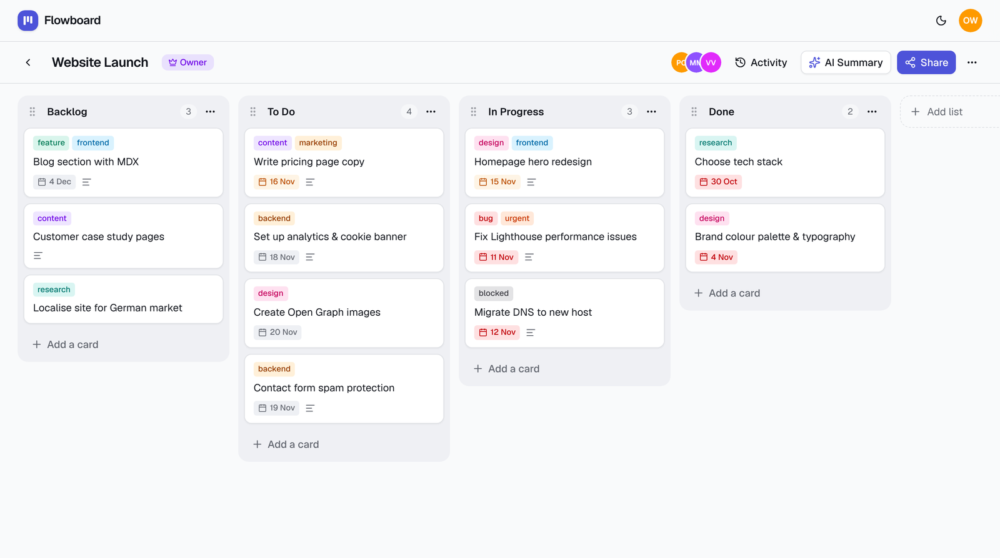
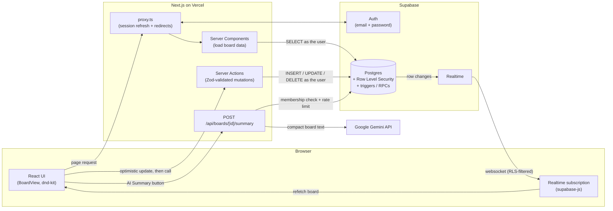
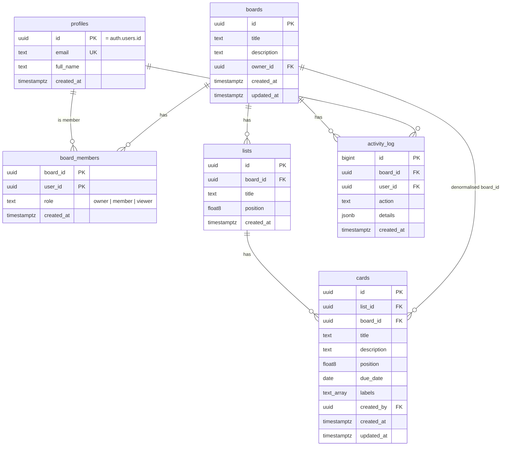

# Flowboard — a collaborative Kanban board

Trello-style project management with **boards, lists and cards**, smooth **drag-and-drop**,
**realtime sync**, **role-based access (owner / member / viewer) enforced in the database**, and an
**AI board summary** powered by Google Gemini.

**Live demo:** `https://<your-app>.vercel.app` ← _replace after deploying_


<!-- Screenshot of the demo board. Swap in a GIF of your deployed app if you like. -->

---

## Features

- **Boards, lists, cards** — create, rename, delete; cards have a title, description, due date and labels.
- **Drag-and-drop** (dnd-kit) — reorder cards inside a list, move cards between lists (including
  empty lists), reorder lists. Works with **mouse, touch (press & hold) and keyboard**
  (Space to pick up, arrows to move, Space to drop, Esc to cancel). Smooth drag overlay.
- **Optimistic updates** — the UI moves instantly, then saves; on error it rolls back and shows a toast.
- **Saved & synced** — everything is stored in Supabase Postgres, so it survives a refresh and works
  across devices. **Supabase Realtime** pushes changes to every open browser live.
- **Roles (bonus #1)** — owner / member / viewer, enforced with **Row Level Security**:
  share dialog (invite by email, change roles, remove people), role badge, read-only mode for
  viewers, "a board always keeps one owner" rule. See [docs/rbac.md](docs/rbac.md).
- **AI board summary (bonus #2)** — progress, work in progress, blockers & overdue items, and 3
  suggested next actions, generated by Gemini on the server and rate-limited to 1 request per board per 30 s.
- **Activity log** — an audit trail written by database triggers (who added/moved/edited what).
- **Auth** — email + password, plus one-click **demo accounts** on the login page.
- **Polish** — dark mode, responsive (mobile snap-scrolling board), loading skeletons, empty states,
  error boundaries, accessible dialogs and screen-reader drag announcements.

## Tech stack (and why)

| Layer         | Choice                                                           | Why                                                                                      |
| ------------- | ---------------------------------------------------------------- | ---------------------------------------------------------------------------------------- |
| Framework     | **Next.js 16 (App Router) + TypeScript (strict)**                | Server Components for fast first load, Server Actions for mutations, one deployable app. |
| Styling / UI  | **Tailwind CSS v4 + shadcn/ui** (Radix primitives)               | Accessible components I own and can restyle; consistent design tokens; dark mode.        |
| Database/Auth | **Supabase** (Postgres, Auth, RLS, Realtime) via `@supabase/ssr` | Real SQL, security in the database itself, realtime out of the box, generous free tier.  |
| Drag-and-drop | **@dnd-kit/core + @dnd-kit/sortable**                            | Maintained, accessible (keyboard + screen readers), supports multiple containers.        |
| Validation    | **Zod**                                                          | Every Server Action validates its input before touching the database.                    |
| AI            | **Google Gemini** (REST, server-only)                            | Free API key from Google AI Studio; key never reaches the browser.                       |
| Feedback      | **sonner** toasts, **lucide-react** icons                        | Small, good-looking defaults.                                                            |
| Tests         | **Vitest** + **PGlite** (Postgres in WebAssembly)                | Unit tests for ordering/permissions **and** real RLS tests against the actual migration. |
| Hosting       | **Vercel** (Hobby, free, no credit card)                         | Zero-config Next.js hosting.                                                             |

## Architecture



**Key idea:** every query runs _as the signed-in user_ (the Supabase client is created from the
user's cookies), so Postgres Row Level Security decides what each person can read or change. The
Next.js code never needs a service-role key.

## Data model



- A **profile** is created automatically by a trigger when someone signs up.
- When a **board** is created, a trigger adds the creator to `board_members` as **owner**.
- `ON DELETE CASCADE` everywhere it makes sense (delete a board → its lists, cards, members, log).
- Indexes on `(board_id, position)`, `(list_id, position)`, `board_id`, `user_id`.
- Everything is in one migration: [`supabase/migrations/20261113000000_init.sql`](supabase/migrations/20261113000000_init.sql).

## Roles (RBAC)

| Action                                      | Viewer | Member | Owner |
| ------------------------------------------- | :----: | :----: | :---: |
| Read board, lists, cards, members, activity |   ✅   |   ✅   |  ✅   |
| AI summary                                  |   ✅   |   ✅   |  ✅   |
| Create / edit / move / delete lists & cards |   ❌   |   ✅   |  ✅   |
| Rename / delete board                       |   ❌   |   ❌   |  ✅   |
| Invite, change roles, remove members        |   ❌   |   ❌   |  ✅   |

Non-members see nothing. The last owner can't be removed or demoted. Full details, and how each
rule maps to SQL: **[docs/rbac.md](docs/rbac.md)**.

## How drag-and-drop ordering works

Lists and cards have a numeric `position` (a `double precision`). The UI sorts by it.

| Situation                   | New position                     |
| --------------------------- | -------------------------------- |
| First item in an empty list | `1000`                           |
| Append to the end           | `last + 1000`                    |
| Drop between two items      | midpoint: `(before + after) / 2` |
| Drop at the very top        | `first / 2`                      |

So a drag-and-drop **updates exactly one row** — no matter how long the list is.

Midpoints halve the gap every time, so after ~20–40 drops into the _same_ spot the gap gets tiny.
When the gap drops below `0.001`, the client re-spaces that list locally to `1000, 2000, 3000…`
and the server calls the `rebalance_list_cards` / `rebalance_board_lists` SQL function, which does
the same thing in one `UPDATE`. Logic: [`lib/positions.ts`](lib/positions.ts) (unit-tested).

The drag itself (in [`components/board/board-canvas.tsx`](components/board/board-canvas.tsx)):

1. **onDragStart** – save a snapshot of the board (for rollback).
2. **onDragOver** – when a card crosses into another list, move it there locally so that list opens a gap.
3. **onDragEnd** – work out the final index → compute the new position → update the UI instantly →
   call the `moveCard` / `moveList` Server Action. If it fails, restore the snapshot and show a toast.
4. Other browsers get a Realtime event and refetch the board.

## Getting started (local)

Requirements: **Node.js 20.9+** (22 recommended) and a free Supabase account.

```bash
git clone https://github.com/<you>/flowboard.git
cd flowboard
npm install
cp .env.example .env.local      # then fill in the values (see below)
npm run dev                     # http://localhost:3000
```

| Script              | What it does                                   |
| ------------------- | ---------------------------------------------- |
| `npm run dev`       | Start the dev server                           |
| `npm run build`     | Production build                               |
| `npm run lint`      | ESLint (Next.js + TypeScript + Prettier rules) |
| `npm run typecheck` | Generate route types + `tsc --noEmit`          |
| `npm run test`      | Vitest: ordering, permissions, RLS (128 tests) |
| `npm run format`    | Prettier                                       |

### Environment variables

| Name                            | Where to get it                                               | Secret?                |
| ------------------------------- | ------------------------------------------------------------- | ---------------------- |
| `NEXT_PUBLIC_SUPABASE_URL`      | Supabase → **Connect** (or Project Settings → Data API)       | No                     |
| `NEXT_PUBLIC_SUPABASE_ANON_KEY` | Supabase → **Connect** → publishable key (or legacy anon key) | No (RLS protects data) |
| `GEMINI_API_KEY`                | Google AI Studio → **Get API key**                            | **Yes** — server only  |
| `GEMINI_MODEL`                  | e.g. `gemini-3.6-flash` (any free-tier text model)            | No                     |

## Supabase setup

1. Create a project at [supabase.com/dashboard](https://supabase.com/dashboard) (free plan).
2. **SQL Editor → New query** → paste all of `supabase/migrations/20261113000000_init.sql` → **Run**.
   This creates the tables, triggers, functions, RLS policies, and turns on Realtime for
   `boards`, `board_members`, `lists`, `cards`.
3. **Connect** (top of the dashboard) → copy the **Project URL** and the **publishable/anon key** into `.env.local`.
4. **Authentication → Sign In / Providers → Email**: for an easy demo, turn **off** "Confirm email"
   (otherwise new users must click a link in their inbox first).
5. Create the demo users (next section) and run `supabase/seed.sql` in the SQL Editor.
6. After deploying: **Authentication → URL Configuration** → set **Site URL** to your Vercel URL and
   add `https://<your-app>.vercel.app/**` to **Redirect URLs**.

> Realtime check: **Database → Publications → supabase_realtime** should list the 4 tables. The
> migration does this for you; you can also toggle them there by hand.

## Demo accounts

| Email             | Password       | Role on "Website Launch" |
| ----------------- | -------------- | ------------------------ |
| `owner@demo.app`  | `DemoPass123!` | Owner                    |
| `member@demo.app` | `DemoPass123!` | Member                   |
| `viewer@demo.app` | `DemoPass123!` | Viewer (read-only)       |

**How to create them:** Supabase → **Authentication → Users → Add user → Create new user** → enter
the email + password and tick **Auto Confirm User**. Do this 3 times, then run
[`supabase/seed.sql`](supabase/seed.sql) in the SQL Editor. It builds the **Website Launch** board
(Backlog / To Do / In Progress / Done, 12 realistic cards with labels and due dates relative to
today) and gives each demo user their role. It is safe to run again.

Tip: open the board as `owner@demo.app` in one browser and `viewer@demo.app` in a private window
to see realtime updates and read-only mode side by side.

## Deploy to Vercel

1. Push this repo to GitHub (public).
2. [vercel.com/new](https://vercel.com/new) → **Import** the repo (framework: Next.js, defaults are fine).
3. Add the 4 environment variables from `.env.example` → **Deploy**.
4. Copy the deployment URL into Supabase → **Authentication → URL Configuration** (Site URL + Redirect URLs).
5. Put the URL at the top of this README.

## Testing

```bash
npm run test
```

- `tests/positions.test.ts` — fractional ordering + rebalancing.
- `tests/permissions.test.ts` — the role matrix, last-owner rule, and a check that the UI matrix
  matches the SQL policies.
- `tests/rls.test.ts` — loads the **real migration and seed** into PGlite (Postgres compiled to
  WebAssembly) with a small stub of Supabase's `auth` schema, then acts as owner, member, viewer,
  a stranger and an anonymous visitor to prove every RLS rule (no Supabase project needed).
- `tests/board-logic.test.ts` — board state helpers, due dates, labels, AI prompt builder.

## Decisions I made

- **Next.js 16**: middleware is now called **proxy** (`proxy.ts`). Same job: refresh the Supabase
  session cookie on every request and redirect signed-out users. `cacheComponents` is off because
  every page is per-user.
- **Server Actions for mutations, browser client for reads after realtime events.** Both run as the
  user, so RLS is the single source of truth.
- **Board ids are generated in the app** (`crypto.randomUUID()`), and the board is inserted without
  `RETURNING`. Postgres checks the SELECT policy for `RETURNING` _before_ the "add creator as owner"
  trigger runs, so asking for the row back would be rejected.
- **`cards.board_id` is denormalised** for fast RLS checks and Realtime filtering, and a trigger always
  copies it from the parent list so it can't be spoofed.
- **Realtime → refetch** instead of patching state from each event: simpler and always correct. Refetches
  wait while a drag or a save is in progress so the UI never jumps. Supabase can't filter DELETE events,
  so deletes are matched against ids currently on screen.
- **Invites need an existing account** (as specified). The error tells the owner to ask them to sign up.
- **AI rate limit lives in Postgres** (`claim_ai_summary_slot`) so it works across all serverless
  instances; the 30 s cooldown is hard-coded in SQL so clients can't change it.
- **Activity log is written by triggers**, never by the client, so it can't be faked.
- **shadcn/ui components are checked in** under `components/ui` (that's how shadcn works); `components.json`
  is included so `npx shadcn add …` keeps working.
- `types/database.ts` matches `supabase gen types` output; regenerate with
  `npx supabase gen types typescript --project-id <ref> > types/database.ts` after schema changes.

## Project structure

```
app/
  (auth)/login, (auth)/signup     sign-in / sign-up pages (+ "Try demo")
  (app)/boards                    board grid
  (app)/boards/[id]               board page (server loads data → <BoardView/>)
  api/boards/[id]/summary         AI summary route handler
  auth/callback                   email-confirmation handler
components/
  ui/                             shadcn/ui primitives
  board/                          BoardView, BoardCanvas (dnd), header, share/AI/activity dialogs, hooks
  list/                           ListColumn, ListHeader, AddListForm
  card/                           SortableCard, CardDialog, AddCardForm, badges
  boards/, auth/, layout/         board grid, auth forms, header/theme/user menu
lib/
  supabase/                       browser + server clients, proxy session helper
  actions/                        Server Actions (boards, lists, cards, members, auth)
  positions.ts                    fractional ordering helper
  permissions.ts                  role → permission matrix (UI side)
  validators.ts                   Zod schemas
  ai/                             board digest + Gemini client
types/                            database.ts (Supabase types) + app types
supabase/                         migrations/…_init.sql, seed.sql
tests/                            Vitest tests
docs/rbac.md                      permission matrix
proxy.ts                          Next.js 16 proxy (session refresh)
```

## What I'd improve next

- **Card comments** and **@mentions**, with notifications.
- **Attachments** via Supabase Storage (with RLS on the bucket).
- **Invite by link** / invite people who haven't signed up yet (pending invites table + email).
- **Undo** for moves and deletes (keep a short history of inverse operations).
- **Offline support** — queue mutations in IndexedDB and replay when back online.
- **E2E tests with Playwright** against a local Supabase (`supabase start`) in CI.
- **Pagination / virtualisation** for huge boards (render only visible cards).
- Patch state directly from Realtime payloads instead of refetching, plus presence ("who's viewing").
- Card assignees, checklists, filters and search.
